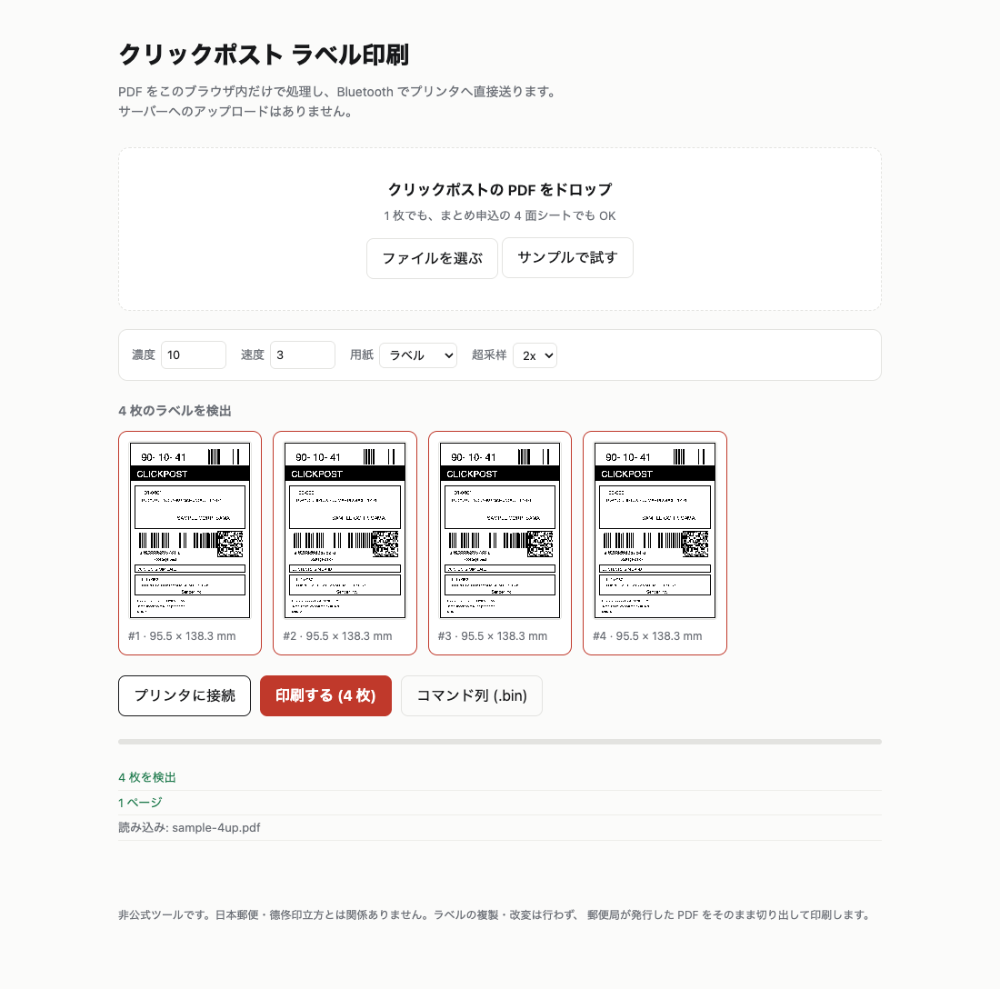

# clickpost-printer

[](https://github.com/clementatt/clickpost-printer/actions/workflows/ci.yml)
[](LICENSE)

[简体中文](README.zh-CN.md) ・ **[在线 DEMO](https://clickpost.l-l.li/)**（サンプルサイト / no data leaves the browser）

**クリックポスト**（日本郵便）のラベル PDF から A6 の運単を切り出し、**DeTong DP305P** 系の
サーマルラベルプリンタ（76 × 130 mm）で直接印刷するツールです。
公式アプリもクラウドサービスも経由しません — プリンタの BLE / USB プロトコルを直接叩きます。

2 つのフロントエンドがあります。

| | CLI (Python) | Web (ブラウザ) |
|---|---|---|
| できること | PDF → 300 dpi ビットマップ → コマンド列 → BLE / USB 印刷、まとめ申込 CSV の生成・検証 | PDF をドロップ → ラベル検出 → **Web Bluetooth で直接印刷** |
| 必要なもの | Python 3.10+ | Chrome / Edge（デスクトップ） |
| データの扱い | ローカルのみ | **PDF は一切アップロードされません**（すべてブラウザ内） |
| 向いている場面 | 自動化・バッチ・CSV 連携 | その場で 1 枚、人に渡す、スマホ以外の PC から |

```
PDF (A4) ──裁切线でグリッド分割──▶ A6 ラベル ──300dpi──▶ 1-bit ──▶ 1f 2a/2b/2e 命令列 ──▶ BLE / USB
```

## 特徴

- **裁切线から自動でラベルを検出**。1 面の A4 でも、まとめ申込の **2 × 2 = 4 面**でも、
  空白の区画は捨てて、読む順（上から下、左から右）に並べます。
- **ラベルの外枠に合わせてトリミング**。A6 の余白や `（切り取る）` の注記を落として
  76 mm 幅に等比縮小するので、文字ができるだけ大きくなります。
- **画素ではなくベクタで判定**。裁切线は 1.5 pt のヘアラインで、ラベルの白塗りに
  隠れがちですが、パスセグメントとして見れば確実に取れます。
- **コマンド列は Python 実装とバイト単位で一致**（テストで固定フィクスチャと比較）。
- ラベルの**改変は一切しません**。郵便局が発行した PDF をそのまま切り出して印刷します。

## クイックスタート — CLI

```bash
python3 -m venv .venv && . .venv/bin/activate
pip install -e '.[ble]'          # USB も使うなら '.[ble,usb]'

dzpost info   ~/Downloads/label.pdf              # どう切るか確認
dzpost render ~/Downloads/label.pdf -o out/p.png --bitmap
dzpost print  ~/Downloads/label.pdf --dry-run out/l.bin   # プリンタなしで命令列だけ
dzpost print  ~/Downloads/label.pdf --labels all          # 4 面を連続印刷（BLE）
sudo .venv/bin/dzpost print ~/Downloads/label.pdf --transport usb
```

### まとめ申込 CSV

```bash
dzpost csv build batch/orders.json -o batch/clickpost-4.csv   # Shift-JIS / CRLF
dzpost csv validate batch/clickpost-4.csv                    # 桁数・敬称・文字幅・40 件上限
```

## クイックスタート — Web

```bash
cd web
npm install
npm run dev        # http://localhost:5173
```

**オンライン DEMO: <https://clickpost.l-l.li/>** — サーバーに何も送らないデモサイトです
（PDF はブラウザ内で処理、印刷だけがローカルの BLE プリンタへ）。

ブラウザで PDF をドロップ（または「サンプルで試す」）→ 検出されたラベルを確認 →
「プリンタに接続」→「印刷する」。印刷後は**印刷ログ（CSV / JSON）**を書き出せます
（日時・ファイル・ページ・通し番号・追跡番号・サイズ・バイト数・sha256・状態）。


**Chrome / Edge のデスクトップ版**が必要です
（Web Bluetooth は Safari / Firefox 非対応）。

> Web Bluetooth はユーザー操作からしか接続できません。また、プリンタは同時に 1 台の
> セントラルとしか繋がらないので、スマホアプリ等が繋いでいる場合は切断してください。

## 仕組み

1. **裁切线を見つける** — 用紙の端まで届く長い縦横の線分を PDF のパスから拾い、
   x / y の区切り位置にする。フレームの線は端に届かないので混ざらない。
2. **グリッドを作る** — 隣り合う区切りの間をセルにし、A6 のアスペクト比に入るものだけ残す。
3. **空のセルを捨てる** — セル内の線分がセルの 40 % 未満しか覆っていなければ空白とみなす。
4. **外枠に寄せる** — セル内の長い線分（端に接していないもの）の外接矩形がラベルの外枠。
   そこに 1 mm の余白を足して切り出し矩形にする。
5. **レンダリング** — 2 倍で描いて Lanczos で縮小し、128 で二値化。
6. **命令列** — `1b 40` / `1b 4a` / `1f 2a` / `1f 2b` / `1f 2e` / `0c` に符号化して送信。

プリンタ側のプロトコル（USB HID と BLE の違い、フロー制御、濃度・速度）は
[`docs/PROTOCOL.md`](docs/PROTOCOL.md) にまとめてあります。

## 動作確認済みの環境

| | |
|---|---|
| プリンタ | DeTong DP305P（`3533:5C32`、300 dpi、960 dot ヘッド、76 × 130 mm ラベル） |
| OS | macOS（Apple Silicon）。Linux は udev ルールで USB 可、BLE も可 |
| 用紙 | クリックポスト A6 ラベル（105 × 148 mm）を 76 mm 幅に等比縮小 |
| 実績 | 1 面・4 面シートを実機で印刷済み（チェックサム検証とページカウンタで確認） |

## 開発

```bash
# CLI
python -m unittest discover -s tests        # 58 ケース

# Web
cd web
npm test                                    # 11 ケース（detect / protocol）
npm run verify:pdf -- public/sample-4up.pdf # 実 PDF でラベル検出を確認
npm run build
```

CI（GitHub Actions）は両方のテストと `npm run build` を回します。

## 注意

- **非公式**です。日本郵便、ClickPost、德佟印立方（DeTong）とは関係ありません。
- ラベルの**複製・改変は行いません**。郵便局が発行した PDF をそのまま切り出します。
- 運単 PDF には氏名・住所が入っています。`fixtures/local/` と `web/public/sample-*.pdf`
  以外の実データはリポジトリに入れないでください（`.gitignore` 済み）。
- 通信は BLE / USB のみ。Web 版はネットワークに何も送りません。

## ライセンス

本プロジェクトは **MIT** です。ただしコマンド列エンコーダ
（`src/dzpost/protocol.py` / `web/src/protocol.ts`）は
[dz-print](https://github.com/sb-child/dz-print)（**MPL-2.0**）の派生物なので、
この 2 ファイルだけ **MPL-2.0** が適用されます（ファイル単位のコピーレフト）。

- `LICENSE` — MIT（上記 2 ファイル以外）
- MPL-2.0 の全文 — <https://mozilla.org/MPL/2.0/>
